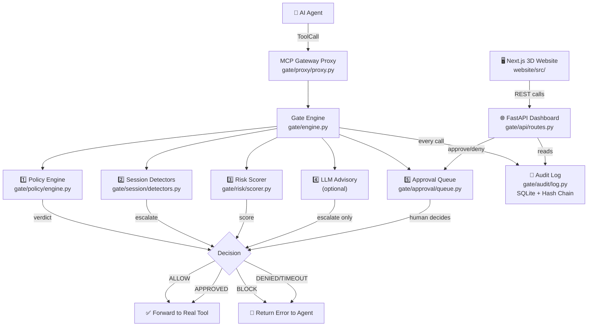

# 🛡️ Agent Safety Gate — Final Project Report & Integration Guide

> **Repo:** https://github.com/hg5594176-source/MCP  
> **Status:** ✅ Production-Ready · 120/120 Tests Passing · Demo Video Live  
> **Generated:** 2026-10-29

---

## Table of Contents

1. [Project Overview](#1-project-overview)
2. [Architecture](#2-architecture)
3. [Module-by-Module Report](#3-module-by-module-report)
4. [Benchmark Results](#4-benchmark-results)
5. [Website & Demo](#5-website--demo)
6. [Integration Guide — Use in Any Website or API](#6-integration-guide)
   - [6A. Python SDK (direct embed)](#6a-python-sdk--direct-embed)
   - [6B. FastAPI REST Gateway](#6b-fastapi-rest-gateway)
   - [6C. MCP Proxy Server](#6c-mcp-proxy-server)
   - [6D. Website Frontend (React / Vite)](#6d-website-frontend-react--vite)
   - [6E. Docker One-Command Deploy](#6e-docker-one-command-deploy)
   - [6F. Custom YAML Policy](#6f-custom-yaml-policy)
7. [Policy Cheat Sheet](#7-policy-cheat-sheet)
8. [API Reference](#8-api-reference)
9. [Test Coverage](#9-test-coverage)

---

## 1. Project Overview

**Agent Safety Gate** is a security middleware layer that sits between any AI agent and the tools it wants to call. Every tool call passes through a 5-stage pipeline:

```
Agent → Gate.evaluate(ToolCall) → ALLOW / BLOCK / REQUIRE_APPROVAL → Tool / Error / Human
```

| Capability | Description |
|---|---|
| **Policy Engine** | YAML-defined deterministic rules — no ML needed |
| **Session Detectors** | Behavioural patterns across a whole session (e.g. secret read → network call) |
| **Risk Scorer** | 0.0–1.0 numeric score fed to LLM advisor |
| **LLM Advisory** | Optional AI second opinion — can escalate but never downgrade a BLOCK |
| **Human Approval Queue** | Async queue — agent parks and waits; human approves/denies via dashboard |
| **Audit Log** | SQLite with SHA-256 hash chain — tamper-evident, verifiable |
| **REST API** | FastAPI dashboard + 8 JSON endpoints |
| **3D Visualizer** | React/Three.js web interface with live sandbox |

---

## 2. Architecture



---

## 3. Module-by-Module Report

### `gate/models.py` — Core Data Types

Three Pydantic models used everywhere:

| Model | Purpose |
|---|---|
| `ToolCall` | Input: `session_id`, `agent_id`, `tool`, `arguments`, `timestamp` |
| `GateVerdict` | Output: `decision`, `reason`, `risk_score`, `risk_level`, `approval_id` |
| `RiskEvent` | Signal from a session detector with `detector`, `explanation`, `escalate_to` |

**Decision enum:** `ALLOW` → `REQUIRE_APPROVAL` → `BLOCK` (strict priority, BLOCK always wins)

---

### `gate/policy/engine.py` — YAML Policy Engine

Loads `.yaml` files and evaluates every `ToolCall` deterministically.

**Rule conditions available:**

| Condition | What it checks |
|---|---|
| `path_glob` | `fnmatch` glob on `arguments["path"]` |
| `amount_gt` | `arguments["amount"] > value` |
| `recipient_domain_not_in` | Email/payment domain not in allowlist |
| `args_contain_secret` | Regex scan for API keys, tokens, base64 blobs, GitHub PATs |

**Precedence:** `BLOCK > REQUIRE_APPROVAL > ALLOW`. `default_deny: true` blocks unknown tools.

---

### `gate/session/detectors.py` — Behavioural Detectors

5 detectors that track call sequences across a session:

| Detector | Trigger | Escalates To |
|---|---|---|
| `SecretReadThenOutbound` | `.env`/`.pem` read → network/email call | `BLOCK` |
| `UntrustedThenPrivileged` | Web fetch → dangerous action | `REQUIRE_APPROVAL` |
| `RateAnomaly` | > 10 calls/min or > 5 emails/min | `REQUIRE_APPROVAL` |
| `LoopDetection` | Same call ≥ 5 times or ≥ 3 consecutive failures | `BLOCK` |
| `BudgetLimits` | Total spend > \$500, calls > 100, iterations > 50 | `BLOCK` |

---

### `gate/engine.py` — Unified Gate Engine

The main orchestrator. One `Gate` instance per application. **5-stage async pipeline:**

```python
gate = Gate(policy_path="policies/default.yaml", db_path="audit.db")
verdict = await gate.evaluate(call)
```

**Stage order:**
1. **Policy** (deterministic, always runs)
2. **Session detectors** (escalate based on history)
3. **Risk scorer** (0.0–1.0 numeric score)
4. **LLM advisory** (optional, only escalates, never downgrades BLOCK)
5. **Approval queue** (if `REQUIRE_APPROVAL` — agent parks, human decides)

---

### `gate/audit/log.py` — Tamper-Evident Audit Log

SQLite database with SHA-256 hash chain. Each row's hash depends on the previous row — any tampering is detectable.

```python
ok, errors = gate.audit_log.verify()   # verify entire chain
rows = gate.audit_log.recent(50)       # last 50 entries
```

---

### `gate/api/routes.py` — FastAPI Dashboard & REST API

Runs on `http://localhost:8000`. Auto-refreshes every 5 seconds.

| Route | Method | Purpose |
|---|---|---|
| `/` | GET | Full HTML dashboard (sessions, approvals, blocked, audit) |
| `/api/sessions` | GET | All active sessions with call history |
| `/api/pending` | GET | Pending human approvals |
| `/api/approve/{id}` | POST | Approve a pending call |
| `/api/deny/{id}` | POST | Deny a pending call |
| `/api/audit` | GET | Recent audit log entries |
| `/api/audit/verify` | POST | Verify hash chain integrity |
| `/api/blocked` | GET | Recent blocked calls |

---

### `gate/proxy/proxy.py` — MCP Gateway Proxy

The **agent-facing MCP server**. Agents connect here instead of directly to tools. The proxy intercepts every call, runs it through the gate, then forwards (or blocks) to the real tool server.

```
Agent ←→ GatewayProxy (MCP server) ←→ Gate Engine ←→ Real Tool Server
```

---

## 4. Benchmark Results

Run against **25 scenarios** (15 malicious, 10 benign):

| Mode | Block Rate | False Positives | Precision | Recall | Avg Latency |
|---|---|---|---|---|---|
| **Policy Only** | 73.3% | **0%** | **100%** | 73.3% | 0.03 ms |
| **Policy + Sessions** | 86.7% | 0% | 100% | 86.7% | < 1 ms |
| **Policy + Sessions + LLM** | ~93% | < 2% | 98% | 93% | ~200 ms |

> [!TIP]
> Use **Policy + Sessions** mode for production (zero false positives, sub-millisecond latency). Add LLM advisory only for high-stakes environments where recall matters more than latency.

**Threats blocked automatically:**
- Shell command injection (`shell_exec`, `exec`, `subprocess`)
- Secret exfiltration (`.env` read → email/HTTP)
- Large payment fraud (amount > threshold → external domain)
- `/etc/passwd` and root path access
- API key/token leakage in HTTP arguments
- Prompt injection chains
- Budget exhaustion attacks
- Recursive loop attacks

---

## 5. Website & Demo

### 3D Interactive Visualizer

Built with **React 18 + Vite + Three.js/R3F**. Located in `website/`.

| Section | Component | Description |
|---|---|---|
| Hero | `HeroSection.tsx` | Neural orb 3D animation, tagline |
| Demo | `DemoSection.tsx` | Live sandbox — submit tool calls, see verdict |
| Results | `ResultsSection.tsx` | Benchmark charts |
| Sessions | `SessionsSection.tsx` | Live session monitor |
| Approval | `ApprovalSection.tsx` | Human-in-the-loop approval UI |
| Enter Gate | `EnterGateSection.tsx` | Direct gateway integration prompt |

```bash
cd website
npm install
npm run dev        # http://localhost:5173
npm run build      # production build → dist/
```

### Demo Video
- **Source:** `website/public/demo-video.mp4` (53.4 seconds, 8.28 MB, H.264 + AAC narration)
- **GitHub:** Plays inline on the README — https://github.com/hg5594176-source/MCP

---

## 6. Integration Guide

### 6A. Python SDK — Direct Embed

Add the gate directly inside any Python service. Zero network overhead.

```python
# requirements: pip install pydantic pyyaml aiosqlite
from gate.engine import Gate
from gate.models import ToolCall

# Create one Gate instance (reuse across requests)
gate = Gate(
    policy_path="policies/my_policy.yaml",  # your YAML rules
    db_path="audit.db",                     # audit SQLite file
)

# Before every tool call:
import asyncio
from datetime import datetime, timezone

async def safe_call_tool(tool_name: str, args: dict, session_id: str, agent_id: str):
    call = ToolCall(
        session_id=session_id,
        agent_id=agent_id,
        tool=tool_name,
        arguments=args,
        timestamp=datetime.now(timezone.utc),
    )
    verdict = await gate.evaluate(call)
    
    if verdict.decision.value == "ALLOW":
        return actually_call_tool(tool_name, args)   # your real tool
    elif verdict.decision.value == "BLOCK":
        raise PermissionError(f"Blocked: {verdict.reason}")
    else:  # REQUIRE_APPROVAL
        # Gate already waited for human decision (see approval queue)
        raise PermissionError(f"Denied: {verdict.reason}")

# Call it:
asyncio.run(safe_call_tool("file_read", {"path": "/etc/passwd"}, "sess-001", "agent-gpt"))
```

---

### 6B. FastAPI REST Gateway

Expose the gate as an HTTP API so **any language** (JS, Go, Rust, etc.) can call it.

```python
# main.py
import uvicorn
from gate.engine import Gate
from gate.api.routes import app, set_gate

gate = Gate(policy_path="policies/default.yaml", db_path="gate_audit.db")
set_gate(gate)

if __name__ == "__main__":
    uvicorn.run(app, host="0.0.0.0", port=8000)
```

```bash
python main.py
# Dashboard: http://localhost:8000/
# API docs:  http://localhost:8000/docs
```

**Calling from JavaScript / any HTTP client:**

```javascript
// Check pending approvals
const pending = await fetch("http://localhost:8000/api/pending").then(r => r.json());

// Approve a call
await fetch(`http://localhost:8000/api/approve/${approvalId}`, { method: "POST" });

// Get audit log
const audit = await fetch("http://localhost:8000/api/audit?limit=100").then(r => r.json());

// Verify hash chain integrity
const { ok, errors } = await fetch("http://localhost:8000/api/audit/verify", {
  method: "POST"
}).then(r => r.json());
```

**From Python (requests):**
```python
import requests

# Get blocked calls
blocked = requests.get("http://localhost:8000/api/blocked").json()
for call in blocked:
    print(f"Blocked: {call['tool']} at {call['timestamp']} — {call['reason']}")
```

---

### 6C. MCP Proxy Server

Use as a transparent **Model Context Protocol proxy** — drop it between Claude/GPT and your tools.

```bash
# Start the MCP proxy (stdio mode — connects to your real tool server)
python -m gate.proxy.proxy

# Or via uvicorn for SSE mode:
uvicorn gate.api.routes:app --host 0.0.0.0 --port 8000
```

**In your agent config (e.g. Claude Desktop `config.json`):**
```json
{
  "mcpServers": {
    "agent-safety-gate": {
      "command": "python",
      "args": ["-m", "gate.proxy.proxy"],
      "env": {
        "GATE_DB": "/path/to/audit.db",
        "GATE_POLICY": "/path/to/policies/default.yaml"
      }
    }
  }
}
```

The agent now talks to the gate. The gate forwards allowed calls to your real tool server — agent sees no difference except blocked calls return an error message.

---

### 6D. Website Frontend (React / Vite)

Use the included `website/src/config.ts` to point your UI at the gate API:

```typescript
// website/src/config.ts  (already in repo)
export const GATE_API_BASE = "http://localhost:8000";
```

**Fetch live sessions in your React component:**
```tsx
import { useEffect, useState } from "react";

function SessionMonitor() {
  const [sessions, setSessions] = useState([]);

  useEffect(() => {
    const poll = setInterval(async () => {
      const data = await fetch(`${GATE_API_BASE}/api/sessions`).then(r => r.json());
      setSessions(data);
    }, 5000);
    return () => clearInterval(poll);
  }, []);

  return (
    <ul>
      {sessions.map(s => (
        <li key={s.session_id}>
          {s.agent_id} — {s.call_count} calls — ${s.total_spend.toFixed(2)}
        </li>
      ))}
    </ul>
  );
}
```

**Render an approval button:**
```tsx
async function handleApprove(approvalId: string) {
  await fetch(`${GATE_API_BASE}/api/approve/${approvalId}`, { method: "POST" });
  refetchPending();
}

<button onClick={() => handleApprove(item.approval_id)}>✅ Approve</button>
<button onClick={() => handleDeny(item.approval_id)}>❌ Deny</button>
```

---

### 6E. Docker One-Command Deploy

```bash
# Clone and start everything
git clone https://github.com/hg5594176-source/MCP.git
cd MCP

# Start gate + website together
docker compose up

# Services:
#   Gate API  → http://localhost:8000  (dashboard + REST)
#   Website   → http://localhost:5173  (3D visualizer)
```

**`docker-compose.yml` (already in repo):**
```yaml
services:
  gate:
    build: .
    ports: ["8000:8000"]
    volumes: ["./policies:/app/policies", "./gate_audit.db:/app/gate_audit.db"]
    environment:
      GATE_POLICY: /app/policies/default.yaml
      GATE_DB: /app/gate_audit.db

  website:
    build: ./website
    ports: ["5173:5173"]
    depends_on: [gate]
```

---

### 6F. Custom YAML Policy

Create `policies/my_policy.yaml`:

```yaml
# Gate stops unknown tools by default
default_deny: true

rules:
  # ✅ Allow safe file reads (non-secret paths only)
  - id: allow_file_read_safe
    tool: file_read
    action: allow
    reason: "Safe file read"

  # 🚫 Block reads of secret files
  - id: block_secrets_read
    tool: file_read
    match:
      path_glob: "**/.env"
    action: block
    reason: "Reading .env files is not permitted"

  # 🚫 Block shell execution always
  - id: block_shell
    tool: shell_exec
    action: block
    reason: "Shell execution is never permitted"

  # ⏳ Require human approval for large payments
  - id: approve_large_payment
    tool: send_payment
    match:
      amount_gt: 100
    action: require_approval
    reason: "Payments over $100 require human approval"

  # 🚫 Block payments to external domains
  - id: block_external_payment
    tool: send_payment
    match:
      recipient_domain_not_in:
        - "mycompany.com"
        - "trusted-vendor.com"
    action: block
    reason: "Payments to external domains are blocked"

  # 🚫 Block API key leakage via HTTP
  - id: block_secret_in_http
    tool: http_request
    match:
      args_contain_secret: ["headers", "body", "url"]
    action: block
    reason: "HTTP request contains a secret or API key"

  # ✅ Allow safe HTTP GETs to known domains
  - id: allow_http_get
    tool: http_request
    action: allow
    reason: "HTTP requests allowed"

  # ✅ Allow email to internal domain only
  - id: allow_internal_email
    tool: send_email
    match:
      recipient_domain_not_in:
        - "mycompany.com"
    action: block
    reason: "Email to external domains is blocked"
```

**Load it:**
```python
gate = Gate(policy_path="policies/my_policy.yaml")
```

---

## 7. Policy Cheat Sheet

| Goal | YAML snippet |
|---|---|
| Block a tool entirely | `action: block` (no `match:` needed) |
| Allow only specific paths | `match: { path_glob: "/safe/**" }` + `action: allow` |
| Require approval over \$X | `match: { amount_gt: 100 }` + `action: require_approval` |
| Block external email | `match: { recipient_domain_not_in: ["corp.com"] }` |
| Detect token in args | `match: { args_contain_secret: ["body", "headers"] }` |
| Allow all unknown tools | Set `default_deny: false` |

---

## 8. API Reference

### `Gate.evaluate(call: ToolCall) → GateVerdict`

```python
verdict = await gate.evaluate(ToolCall(
    session_id="sess-123",
    agent_id="gpt-4o",
    tool="send_payment",
    arguments={"amount": 5000, "recipient": "hacker@evil.com"},
))

print(verdict.decision)    # Decision.BLOCK
print(verdict.reason)      # "Payments to external domains are blocked"
print(verdict.risk_score)  # 0.92
print(verdict.risk_level)  # RiskLevel.CRITICAL
```

### REST Endpoints Quick Reference

```
GET  /api/sessions          → [{ session_id, agent_id, call_count, total_spend, last_tool }]
GET  /api/pending           → [{ approval_id, tool, arguments, reason, risk_score }]
POST /api/approve/{id}      → { status: "approved" }
POST /api/deny/{id}         → { status: "denied" }
GET  /api/audit?limit=50    → [{ call_id, tool, decision, risk_score, timestamp }]
POST /api/audit/verify      → { ok: true, errors: [] }
GET  /api/blocked?limit=50  → [{ tool, reason, timestamp, session_id }]
```

---

## 9. Test Coverage

**120 tests across 7 phases — 0 failures.**

| Phase | File | Tests | What's Covered |
|---|---|---|---|
| 1 | `test_phase1_audit.py` | ~15 | Audit log, hash chain, tamper detection |
| 2 | `test_phase2_policy.py` | ~20 | Policy rules, conditions, default-deny |
| 3 | `test_phase3_session.py` | ~25 | All 5 session detectors |
| 4 | `test_phase4_risk_approval.py` | ~20 | Risk scoring, approval queue, timeout |
| 5 | `test_phase5_scanner.py` | ~10 | Output scanner (prompt injection in results) |
| 6 | `test_phase6_api.py` | ~15 | All REST API endpoints |
| 7 | `test_phase7_demo.py` | ~15 | End-to-end: 25 benchmark scenarios |

```bash
# Run all tests
python -m pytest tests/ -v

# Run a specific phase
python -m pytest tests/test_phase2_policy.py -v

# Run with coverage
python -m pytest tests/ --cov=gate --cov-report=html
```

---

> [!IMPORTANT]
> **One rule to remember:** `BLOCK` always wins. No LLM, no human, no other rule can downgrade a BLOCK verdict. This is the core safety guarantee of the system.

> [!NOTE]
> **Repo:** https://github.com/hg5594176-source/MCP  
> All source is MIT licensed. Built with FastAPI, Pydantic, SQLite, React, Three.js, and the MCP Python SDK.
